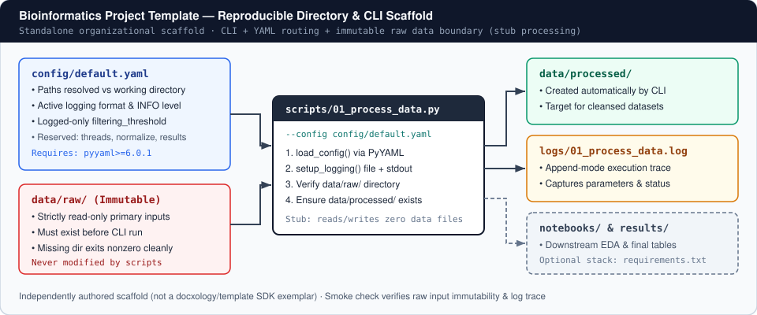

# Bioinformatics Project Template

A standalone directory and configuration scaffold for reproducible projects.
The Python entrypoint loads YAML, checks input routing, creates an output
directory, and appends a log. The shipped processing function is a stub.

Start at the [documentation index](docs/README.md). The [setup and verification
guide](docs/development.md) runs the real CLI with a temporary toy table.
The [technical note](docs/manuscript/README.md) describes the scaffold and
links to the external PDF and HTML build recipe.

Released under the [MIT License](LICENSE).
